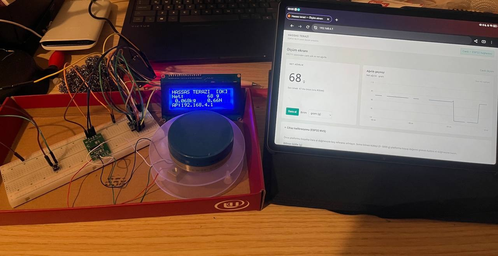

# ESP32 Wheatstone Bridge Precision Scale with HX711

[Turkish build guide: Wheatstone köprülü hassas terazi](README.md)

*ESP32 and HX711 Wheatstone bridge scale: both displays read 68 g.*

Build an ESP32 digital weighing scale using a four-wire, full Wheatstone bridge load cell rated for 5 kg and an HX711 amplifier/ADC. The scale displays live readings on a 20×4 I²C LCD and serves a live chart and calibration controls to a tablet browser over its own Wi-Fi network. No internet connection is required to use the scale.

## Hardware and wiring

| Signal | Connection |
| --- | --- |
| HX711 DOUT / SCK | ESP32 GPIO16 / GPIO4 |
| HX711 VCC / GND | ESP32 3.3 V / common ground, as used in this prototype |
| LCD SDA / SCL | ESP32 GPIO21 / GPIO22 through a bidirectional level shifter for the prototype's 5 V LCD backpack |
| Tare button | GPIO27 to GND; internal pull-up, active low |

The prototype's LCD uses address `0x27`. Connect the load cell to the HX711's `E+`, `E−`, `A+`, and `A−` according to the sensor documentation; wire colors may differ. See the [firmware guide](firmware/README.md) for the full wiring and calibration details.

## Build and calibrate

1. Copy [`firmware/wifi_local.example.h`](firmware/wifi_local.example.h) to `firmware/wifi_local.h` and choose a local Wi-Fi password (8–63 characters). Do not commit the local file.
2. From the repository root, build with `pio run -d firmware -e terazi_main`. To find the upload port, use `pio device list`, then upload with `pio run -d firmware -e terazi_main -t upload --upload-port YOUR_PORT`.
3. Leave the platform empty at startup for automatic tare. Connect to `HassasTerazi` and open `http://192.168.4.1` in a browser.
4. Place a known mass on the platform, enter its mass in grams in the calibration panel, and run calibration. Remove the mass to check the zero return, then try a different known mass to check the result.

Open [`tablet/index.html`](tablet/index.html) directly in a browser to try the offline demo without hardware. The demo does not show real sensor readings.

## Source, simulation, and tests

- [`firmware/`](firmware/): ESP32 firmware for weighing, tare, calibration, LCD, and the local web server.
- [`tablet/`](tablet/): browser dashboard and client tests. Run `node --test tablet/tests/core.test.cjs` from the repository root.
- [`examples/`](examples/): standalone HX711 raw ADC and I²C address diagnostics.
- [`simulasyon/`](simulasyon/): ideal Wheatstone bridge simulation, results at 21 load points, and archived software test outputs. These are not physical measurements or an accuracy guarantee.

The 5 kg figure is the load cell's nominal rating, not a verified accuracy or range specification for the assembled prototype.
